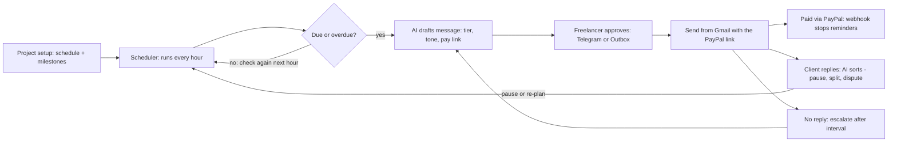

# AI Freelancer Payment Recovery: MVP Spec v2

Exported from the shared doc on 2 Nov 2026. If the shared doc changes, re-export it to this file.

Changed on 3 Nov 2026 (approved): installments replace PayPal partial payments, and freelancers get invoice templates. The approved change is `docs/CHANGE-installments-and-templates.md`; this spec now includes it.

## Overview

The product gets cross-border freelancers paid on time in two ways: it protects payment before work starts (deposits and milestone holds), and it recovers payment after a deadline passes (AI-drafted, freelancer-approved reminders with a PayPal pay link in every message).

**The problem.** Late payment is the norm for freelancers: 65% wait more than 30 days to get paid. Cross-border work adds bank fees, currency loss and no visibility into where the money is.

**What changed from v1**

- **Prevention, not just recovery:** optional milestones, deposits and short-term payment holds, plus monthly retainers and maintenance reminders for repeat work.
- **Freelancer-set rules:** deadlines, payment terms, reminder intervals, escalation tiers and send windows are all configurable.
- **Reads client replies:** a reply like "I'll pay on the 15th" pauses or reroutes the sequence instead of triggering another reminder.
- **Human approval:** the freelancer reviews every draft in the dashboard Outbox or on Telegram before it goes out; final notices always need approval.
- **Bring your own AI:** any cloud model (Claude, OpenAI, Gemini and others) or a local model (Ollama, LM Studio).
- **One PayPal invoice per milestone or per installment**, reused in every reminder. A client who needs to pay in parts gets installments: separate invoices with fixed amounts and their own due dates.
- **Invoice templates:** the freelancer's own invoice document (PDF) from a built-in or custom template.

## Target users and launch markets

The MVP launches only where PayPal lets freelancers receive and withdraw money.

- **Primary users:** solo freelancers and small agencies who bill international clients per project or per milestone.
- **Launch markets:** freelancers in India, the Philippines, Latin America and Sri Lanka (PayPal launched there on May 15, 2026).
- **Not at launch:** Pakistan, Bangladesh and Nigeria. PayPal isn't available for receiving in these countries, even though they have large freelancer populations.
- **Open question:** whether to support those markets later through partner rails, such as Payoneer's PayPal integration in Bangladesh.

## Project setup: deadlines, terms and intervals

Every timing rule is set by the freelancer. Settings are layered: account defaults, then per-client overrides, then per-project or per-milestone overrides. The most specific one wins.

| Setting | What it controls | Default | Options |
| --- | --- | --- | --- |
| Delivery deadline | When the work (or milestone) is due | None, required | Any date |
| Payment terms | When the invoice is due after it's sent | Net 14 | Due on receipt, Net 7 / 14 / 30 / 45 / 60, or a specific date |
| Pre-due reminder | Courtesy note before the due date | 2 days before | Off, or N days before |
| Grace period | Days after the due date before Tier 1 starts | 0 days | 0 to 14 days |
| Reminder interval | Gap between reminders within a tier | Every 3 days | Every N days, or specific dates |
| Max reminders per tier | How many nudges before moving up a tier | 2 | 1 to 5 |
| Tier boundaries | Days overdue that start each tier | 1 / 8 / 22 | Any ascending numbers |
| Send window | When emails may go out, in the client's time zone | Mon to Fri, 9:00 to 17:00 | Any days and hours |
| Client time zone | Used for the send window | From the client's country | Manual pick |
| Late fee | Fee the reminders may mention | None | % per month or flat amount, only if the contract has one |
| Approval mode | Which messages need a tap before sending | Approve all | Auto-send Tier 1; Tier 3 always needs approval |
| Approval nudge | When to remind the freelancer about an unanswered draft, once | 24 hours | 1 to 168 hours |
| Pause or snooze | Stop reminders for a client or project | Off | Pause, or snooze until a date |
| Currency | Invoice currency | USD | Any PayPal-supported currency |

Days overdue are counted in the client's calendar days. Tier 1 starts at its boundary or after the grace period, whichever is later. The interval is also the minimum gap when moving up a tier, and a reminder carries the tier for the day it actually goes out. A courtesy note outside the send window moves to the next slot, and is dropped if that's after the due date. With specific reminder dates, each date is used once and max per tier doesn't apply.

Pause and snooze are stops, so they combine instead of overriding: a pause on any layer pauses, and the latest snooze date wins. Delivery deadline, client time zone and currency are fields on the milestone, client and project, not layered settings.

**Validation rules**

- Tier boundaries must ascend, and intervals must be at least 1 day.
- Warn, don't block, if a payment due date falls before the delivery deadline.
- A schedule change applies to future reminders only; anything already sent stays in the log.

## Milestones (optional)

A project is either one invoice or a milestone plan. Each milestone gets its own deadline, invoice and reminder schedule, so one late milestone doesn't block the others.

**Fields per milestone**

- Name and deliverable description
- Amount, or a % of the project total
- Delivery deadline
- Payment terms (inherited from the project unless changed)
- Acceptance window: days the client has to approve or request changes. Auto-accept after that window only if the contract says so.
- Payment mode (below)

**Payment modes**

| Mode | How it works | Best for |
| --- | --- | --- |
| Pay on invoice | PayPal invoice created when the milestone is delivered | Default, any length |
| Deposit | Installment 1 is invoiced at kickoff for an amount the freelancer sets; the rest is installment 2, invoiced when the milestone is delivered | First milestone, new clients |
| Milestone hold | Client authorizes the payment at milestone start; it's captured on acceptance | Short milestones only |

A pay-on-invoice milestone can also be set to **Pay in installments** (below).

**Installments**

PayPal's partial payments aren't offered in every country, so the app never uses them. Installments are separate PayPal invoices with fixed amounts and their own due dates. They work everywhere, and each payment gets its own reminders, its own paid status and a clear line on the invoice.

- **A plan** splits one milestone (or a single-invoice project's 100% milestone) into 2 to 12 installments. Each has an amount and a due date. Amounts are integer cents and must add up exactly to the milestone amount; an even split rounds each share half up and the last installment absorbs the remainder (the same rule as milestone percentages).
- **One PayPal invoice per installment,** created and sent like any other invoice (invoice number guard, no PayPal emails). Each one has its own reminder schedule from its own due date.
- **When installments are created:**
  - **At setup:** the freelancer picks "Pay in installments" on a pay-on-invoice milestone and sets each installment's amount and due date. All its invoices are created when the milestone is delivered.
  - **Deposit:** installment 1 is due at kickoff. The freelancer sets its amount: more than 0 and less than the milestone amount; the rest is installment 2, invoiced when the milestone is delivered. Each is due per the payment terms from the day it's invoiced. A deposit of the whole milestone amount is one invoice at kickoff, with no plan.
  - **When a client asks to pay in parts:** the reply listener sorts the reply as an installment request and drafts a split of the unpaid remainder (e.g. 2 × $750, due today and on the 15th) for the freelancer to approve. On approval, the open unpaid invoices are cancelled and the installment invoices are created. Nothing changes without approval. An invoice that already has money on it is never cancelled; only the unpaid remainder can be split.
- **What the invoice says** (PayPal's invoice note, plus the item description): "Installment 2 of 3 for Website redesign: Build", then "Milestone total USD 1,500.00 · Paid so far USD 500.00 · This installment USD 500.00 · Remaining after this USD 500.00", then the due dates of the other installments.
- **Statuses:** a milestone with installments is Partially paid while some are paid, and Paid when all are. Installment invoices use the normal invoice statuses.
- **Cancelling:** an installment plan is cancelled as a whole, and only while nothing on it is paid. Once something is paid, only the unpaid remainder can be split again.
- **Reminders and tiers** run per installment. A reminder for installment 2 never mentions installment 3 as overdue unless it is.

PayPal authorizations hold funds for up to 29 days, and capture is most reliable within the first 3 days. After that, the app reauthorizes before capturing. The app warns when a milestone deadline is more than 29 days after the hold.

**Milestone lifecycle:** Planned, In progress, Delivered, Accepted, Invoiced, then Paid. A milestone can also become Partially paid (some installments paid), Overdue or Disputed.

**Example:** a $3,000 website project split into Design (30%, deposit), Build (50%, pay on invoice) and Launch (20%, pay on invoice).

**Validation:** milestone amounts must add up to the project total (or 100%). Deadlines out of order get a warning, not a block.

## Retainers and maintenance reminders

Freelancers can bill a fixed fee on a repeating schedule, and the app reminds them before each maintenance job is due. Recurring income no longer depends on the freelancer remembering it.

**Recurring fees (retainers)**

- **Fields:** name (e.g. "Monthly website maintenance"), amount, currency, interval (every N weeks or months), start date, end date or "until cancelled", and payment method.
- **Payment methods:**

| Method | How it works | Good for |
| --- | --- | --- |
| Auto-pay | Client approves a PayPal subscription once; PayPal charges every cycle | Clients happy to pay automatically |
| Invoice each cycle | App creates a PayPal invoice each cycle and runs the normal reminder schedule | Clients who want to approve each payment |

- **Failed auto-pay:** PayPal retries a failed subscription payment every 5 days, up to 2 times, then adds it to an outstanding balance. The app catches the payment-failed webhook and starts the normal escalation for that cycle: one invoice per cycle, whatever PayPal retries. Outstanding amounts are never billed automatically, because that invoice could then be paid twice. If PayPal's retry collects the money, the invoice is cancelled and its reminders stop. If the invoice already has money on it, the freelancer is told to check for a double payment.
- **Cancelled by the client:** the freelancer gets a Telegram alert and a dashboard flag. The same goes for a suspension.
- **Approving auto-pay:** the dashboard shows the PayPal approval link for the freelancer to send on. The app doesn't email it.

**Maintenance reminders (to the freelancer)**

- **Fields:** client and project, task (e.g. "Security updates and backups"), repeat every N months (e.g. 6), next due date, estimated cost, reminder lead time (default 14 days and 1 day before), optional checklist.
- **What the freelancer gets** on Telegram and in the dashboard, e.g. "Maintenance for Acme website is due on 15 May, estimated $200." The buttons:
  - **Tell the client:** the AI drafts a heads-up with the date and cost, which goes through the normal approval flow.
  - **Create invoice:** uses the existing invoice flow, with an optional deposit (in the dashboard, where an amount can be typed). Each due date gets a small project and milestone of its own, so the original project's total stays as agreed.
  - **Snooze or reschedule:** Snooze waits 7 days and reminds again. Reschedule is in the dashboard, where a date can be picked.
  - **Mark done:** the next due date is set automatically, counted from the done date or from the original date (a setting).
- **Renewals use the same reminder:** domains, hosting and SSL certificates, each with its own repeat interval and cost.
- **Upcoming list:** the dashboard shows the next 90 days of maintenance jobs, renewals and retainer charges, with the expected income. It's a list, not a calendar; a full calendar is planned for later.

These reminders go to the freelancer only. Nothing reaches the client without approval.

## Escalation engine

Reminders escalate on the freelancer's schedule, react to what the client says, and never send without the approval rules being met.

**Default tiers (all editable)**

| Tier | Default timing | Tone and content | Approval |
| --- | --- | --- | --- |
| Courtesy | 2 days before due | Friendly heads-up with the pay link | Optional |
| Tier 1 | 1 to 7 days overdue | Friendly nudge, delivery check-in | Optional |
| Tier 2 | 8 to 21 days overdue | Firm, cites the agreed terms, offers installments | Required by default |
| Tier 3 | 22+ days overdue | Final notice, cites the contract's late-fee clause or a verified law | Always required |

**Reply handling.** Replies on the invoice thread are sorted by the AI:

| Client says | What the app does |
| --- | --- |
| Promises a date | Suggests pausing until the day after that date |
| Asks to pay in parts | Drafts an installment split of the unpaid remainder for the freelancer to approve; on approval the open invoice is replaced by the installment invoices |
| Says they paid another way | Keeps it on hold and asks the freelancer to confirm |
| Disputes the work | Keeps reminders stopped, alerts the freelancer, links the evidence timeline |
| Out of office | Suggests pausing until their return date |
| Unclear or unrelated | Asks the freelancer what to do |

Any reply puts that invoice's reminders on hold, whatever it says, because the hold can only delay a reminder. The AI's sorting only suggests: a pause, a split or a resume happens when the freelancer chooses it. It can never mark an invoice paid, change an amount or change a schedule on its own.

**Approval.** Every draft waits for review in the Outbox and on Telegram (next section). A draft that isn't answered is held, not sent. Approved messages go out from the freelancer's own Gmail, on the original invoice thread.

## Reviewing drafts: Outbox and Telegram

Freelancers review every message in one of two places, and the two stay in sync: a draft handled in one is cleared from the other.

**Dashboard Outbox**

- Each draft shows the client, invoice or milestone, amount, tier, send time (in the client's and the freelancer's time zones), and the full message with its PayPal link.
- **Actions:** Approve, Edit, Skip, Reschedule. An approved draft that hasn't gone out can still be rescheduled or stopped.
- **Filters:** Waiting, Scheduled, Sent, Skipped.
- Sent messages move into the client's history, next to their replies and payments.

**Telegram approvals**

1. **Connect:** in Settings, the freelancer taps "Connect Telegram". This opens the bot with a one-time code (`t.me/<bot>?start=<code>`), and the bot saves their chat ID to their account.
2. **Notify:** when a draft is ready, the bot sends a card with the client, amount, tier, send time and message text.
3. **Decide:** the card has Approve, Edit and Skip buttons.
4. **Edit:** the freelancer replies in plain words, like "make it softer and mention the 15th". The AI redrafts and sends a new card. An "Open in dashboard" link is there for manual edits.
5. **Confirm:** the bot replies "Sent at 10:00 client time" or "Skipped".

**Rules**

- Drafts longer than 4096 characters (Telegram's limit) are sent as a preview with a link to the Outbox.
- Buttons work only from the linked chat ID. Taps from any other chat are ignored.
- Once a draft is handled anywhere, its Telegram card changes to "Already handled in dashboard" and its buttons stop working.
- A card's buttons work only while it shows the current wording and send time. A change in the dashboard or a redraft replaces the card.
- An unanswered draft gets one nudge after 24 hours (default, editable), then stays held. It's never sent on its own.

**Cost:** the Telegram Bot API is free, with no subscription or per-message fees. The only cost is hosting n8n. WhatsApp can be added later if users ask for it, but its business API charges per message.

**Privacy:** Telegram bot chats aren't end-to-end encrypted, so drafts pass through Telegram's servers. Telegram is optional; users can approve in the Outbox only.

## End-to-end workflow

Each reminder runs through draft, approval and send. A PayPal payment ends the loop, a client reply re-plans it, and silence moves it to the next tier after the set interval.

## Bring your own AI

Users pick any cloud or local model in Settings. Every model is reached through one OpenAI-compatible chat call, so the workflows never change when the model does.

- **Local runners** (Ollama, LM Studio, llama.cpp, vLLM) already speak this format.
- **Cloud providers** with an OpenAI-compatible endpoint (Claude, OpenAI, Gemini, Groq, OpenRouter) are called directly. Providers without one (such as Bedrock) go through the local LiteLLM gateway, which translates the call (Custom URL).
- **In n8n,** one "AI Router" sub-workflow calls the app with an HTTP Request node. The app reads the user's base URL, model and key (decrypted only there) from the database at runtime, applies the fallback order and checks the answer. n8n's built-in credentials are per instance, not per user, so they never hold model keys.

**Settings screen**

- **Provider presets:** Claude, OpenAI, Gemini, Groq, OpenRouter, Ollama (local), LM Studio (local), Custom URL.
- **Fields:** base URL, API key (blank for local), model name.
- **Test connection:** runs 4 sample tasks (sort 2 replies, draft a Tier 1 email, draft a Tier 2 email) and shows pass or fail for each.
- **Per-task models (optional):** a small or local model for sorting replies, a stronger one for drafting, the strongest for Tier 3.

**Reliability rules**

- Every AI response must match a JSON schema. On failure: retry once, then fall back to a fixed template. A failed draft is never sent.
- **Fallback order:** local model, then a cloud model (only if the user allows it), then a template. Otherwise the reminder waits until the model is back.
- **Local model reachability:** a cloud-hosted n8n can't reach a user's localhost. Local models need self-hosted n8n on the same machine or network, or a tunnel. The setup guide says so up front.
- Prompts are plain, use no provider-only features, and live in Git next to the workflows.

**Privacy:** with a local model, invoices and client emails never leave the user's machine. For cloud models, an optional toggle strips names and emails before sending and puts them back in the draft.

## PayPal integration

Each milestone, installment or retainer cycle gets one PayPal invoice, and the same link appears in every reminder. Checkout orders are used only for milestone holds.

| Need | PayPal API | Notes |
| --- | --- | --- |
| Invoice a milestone | `POST /v2/invoicing/invoices`, then `/send` | Created once and reused in all reminders |
| Deposit or installments | One invoice per installment, with the same create and send calls | Never PayPal partial payments (`partial_payment`, `allow_partial_payment`, `minimum_amount_due`): they aren't offered in every country. `detail.note` carries the installment line |
| Milestone hold | `POST /v2/checkout/orders` with `intent: AUTHORIZE` | Capture on acceptance; reauthorize after day 3; void if cancelled |
| Cancel an invoice | `POST /v2/invoicing/invoices/{id}/cancel` | When a milestone is dropped |
| Payment status | Webhooks | `INVOICING.INVOICE.PAID`, `PAYMENT.CAPTURE.COMPLETED`, `PAYMENT.CAPTURE.REFUNDED`, `CUSTOMER.DISPUTE.CREATED` |
| Trust the webhook | `POST /v1/notifications/verify-webhook-signature` | Reject anything unverified |
| No duplicates on retry | `PayPal-Request-Id` header, plus a unique invoice number | Header on every create call. Invoicing v2 ignores it, so each invoice also gets a unique number; PayPal refuses a repeat, and a retry reuses the existing invoice |

**Retainers (auto-pay):** `POST /v1/catalogs/products` and `POST /v1/billing/plans` define the fee and interval. `POST /v1/billing/subscriptions` returns an approval link for the client. The app listens for `PAYMENT.SALE.COMPLETED`, `BILLING.SUBSCRIPTION.ACTIVATED`, `BILLING.SUBSCRIPTION.RE-ACTIVATED`, `BILLING.SUBSCRIPTION.PAYMENT.FAILED`, `BILLING.SUBSCRIPTION.SUSPENDED`, `BILLING.SUBSCRIPTION.CANCELLED` and `BILLING.SUBSCRIPTION.EXPIRED`, verified like every webhook. An event only says which subscription to look at: its state is read from PayPal, and amounts come from the retainer. Retainers billed by invoice use the invoice flow above.

**Accounts:** the MVP runs on one sandbox business account. Multi-user launch needs PayPal partner onboarding (partner referrals with invoicing permissions), so each freelancer connects their own account.

**Positioning:** PayPal Invoicing can already send basic reminders. This product's value is the schedule rules, reply handling, AI escalation and milestone protection around it.

## Invoice templates

PayPal's own invoice page can't use custom HTML; it takes only a logo and PayPal's layout. So a template produces **the freelancer's own invoice document, as a PDF**, with the same PayPal pay link used everywhere else. It's attached to the PayPal invoice if the Invoicing API allows attachments in the sandbox (checked 3 Nov 2026: the API has no file upload, so it isn't), always attached to the reminder emails sent from the freelancer's Gmail, and downloadable from the dashboard.

- **Three built-in templates:** Classic (clean, formal), Modern (bold header, accent colour) and Minimal (plain, lots of white space). Each shows the freelancer's name and logo, client details, line items, totals, the installment line, payment terms and the pay link.
- **Custom templates:** the freelancer writes their own HTML and CSS with tags the app fills in. A live preview uses sample data. "Set as default" works per account, overridable per client.
- **Tags:** logic-less placeholders in double braces. An unknown tag is an error shown in the editor, not a blank.

| Group | Tags |
| --- | --- |
| Freelancer | `{{freelancer.name}}`, `{{freelancer.business_name}}`, `{{freelancer.email}}`, `{{freelancer.address}}`, `{{freelancer.logo}}` |
| Client | `{{client.name}}`, `{{client.company}}`, `{{client.email}}`, `{{client.address}}` |
| Invoice | `{{invoice.number}}`, `{{invoice.issue_date}}`, `{{invoice.due_date}}`, `{{invoice.title}}`, `{{invoice.pay_link}}`, `{{invoice.terms}}`, `{{invoice.late_fee_clause}}` |
| Line items | `{{#items}} … {{/items}}` repeating `{{name}}`, `{{description}}`, `{{quantity}}`, `{{unit_price}}`, `{{amount}}`; also `{{expense_1}}`, `{{expense_2}}` … as shortcuts for the first rows |
| Totals | `{{totals.subtotal}}`, `{{totals.tax}}`, `{{totals.discount}}`, `{{totals.total}}`, `{{currency}}` |
| Installments | `{{installment.number}}`, `{{installment.count}}`, `{{installment.paid_so_far}}`, `{{installment.remaining}}`, `{{#installment.schedule}} … {{/installment.schedule}}` |
| AI-written text | `{{greeting}}`, `{{thank_you_note}}`, `{{project_summary}}`, `{{notes}}` |

- **What the AI fills:** only the text tags (greeting, thank-you note, project summary, notes), through the AI router, checked against `prompts/schemas/invoice-text.schema.json`. The freelancer sees and can edit the text before the invoice is created. Everything else (names, amounts, dates, invoice numbers, installment figures, the pay link) comes from the database, with money from the one money formatter. AI text that mentions an amount or a date is rejected and regenerated, or the freelancer writes it.
- **Security (custom HTML is untrusted input):** sanitise on save: strip `<script>`, event handlers (`on*=`), `<iframe>`, `<object>`, `<embed>`, forms, `javascript:` URLs and `@import`, and allow only a known set of tags and CSS properties. No outside resources: no remote images, fonts or stylesheets; images such as the logo are embedded by the app, so the PDF is the same every time and a template can't leak data to another server. Every tag value is HTML-escaped when filled (a logic-less engine such as Mustache). The preview is a sandboxed iframe with no scripts; the PDF is made by headless Chromium with JavaScript disabled and network access off. HTML plus CSS is limited to 100 KB per template.
- **Screens:** Settings > Invoice templates (the built-ins and custom ones; Preview, Duplicate, Set as default), a template editor (HTML and CSS side by side, live preview, click-to-insert tag list, sanitiser errors inline), and on Create invoice a template pick plus the AI-written text with Edit.

## Data model

Fourteen tables cover the MVP (`invoice_templates` arrives with the Invoice templates feature, and `retainer_alerts` with retainers). Schedules are stored as one settings object per level (account, client, project, milestone) and merged at runtime.

| Table | Key fields |
| --- | --- |
| users | id, name, email, time_zone, Gmail token (encrypted), PayPal account, Telegram chat ID, Telegram link code (hash and expiry), default settings, default_template_id, business_name, address, logo (embedded image) |
| ai_providers | user_id, task (sort / draft / tier3), provider, base_url, model, api_key (encrypted), fallback_order |
| clients | user_id, name, email, country, time_zone, settings override, default_template_id (optional), company, address |
| projects | client_id, title, total, currency, contract terms, late-fee clause, settings override, status |
| milestones | project_id, name, deliverable, amount or %, deadline, acceptance window, payment mode, settings override, status |
| retainers | client_id, project_id, name, amount, currency, interval, start, end, method (auto-pay / invoice), paypal_subscription_id, status |
| retainer_alerts | user_id, retainer_id, kind (payment_failed / suspended / cancelled / recovered / paid_twice / activated_after_cancel), telegram_notified_at, dismissed_at. The wording is made from the database when it's shown. |
| maintenance_tasks | project_id, type (maintenance / renewal), task, repeat_months, next_due, est_cost, lead_days, repeat_from (done / scheduled), checklist, status, snoozed_until, last_notice_on, last_done_on, Telegram card fields, job_project_id, job_due_on, Gmail thread fields |
| installment_plans | user_id, milestone_id, count (2 to 12), items (each installment's amount and due date), created_from (setup / deposit / client_request), status (active / completed / cancelled) |
| invoices | milestone_id or retainer_id, paypal_invoice_id, paypal_order_id, link, amount, amount_paid, due_date, status, installment_number, installment_count, installment_plan_id (all null for a plain invoice), template_id, pdf_path, invoice_text |
| invoice_templates | user_id (NULL for the shared built-ins), name, kind (builtin / custom), html, css. The default is kept on users and clients, since a shared built-in can't hold one user's default. |
| reminders | invoice_id or maintenance_task_id (a heads-up has no invoice), maintenance_due_on, tier, scheduled_at (stored in UTC; the send window is worked out in the client's time zone), draft, approval status, approved_via (outbox / telegram), telegram_message_id, sent_at |
| messages | invoice_id or maintenance_task_id, direction (in / out), body, AI classification, thread_id |
| events | entity, type, payload, created_at: the audit log behind the evidence timeline |

## Architecture and tech stack

The stack from v1 stays. The scheduler now runs hourly instead of daily, so messages can land inside each client's send window.

| Layer | Choice |
| --- | --- |
| Frontend | Next.js dashboard: clients, projects, milestones, schedules, approvals, AI settings |
| Orchestration | n8n, self-hosted (needed for local models) or cloud |
| AI | AI Router sub-workflow, then LiteLLM gateway, then any cloud or local model |
| Payments | PayPal Invoicing, Orders and Webhooks |
| Email and approvals | Gmail API via OAuth (gmail.send and gmail.readonly; the app reads only the invoice threads it stored when sending); Telegram Bot API for approval cards |
| Data | Supabase (Postgres) |

**n8n workflows**

1. **Scheduler** (hourly): plans each unpaid invoice's next reminder up to a day ahead, so there's time to approve it, and drafts it. It also creates each cycle's retainer invoice and sends the freelancer's maintenance and renewal reminders.
2. **Drafter:** builds the context, calls the AI Router, validates the JSON, stores the draft. The n8n workflow relays to the app, which does all four with the same router code as `07_ai_router`, so the content checks share its retry-then-template rule.
3. **Approval handler:** posts each draft to the Outbox and to Telegram (a card with buttons, sent by the n8n Telegram node at the app's request), then acts on Approve, Edit or Skip from either place. A Telegram Trigger catches plain-word edit replies and sends them back to the Drafter.
4. **Sender:** sends via Gmail on the original thread and logs it. The first reminder starts the thread, because PayPal's own emails are off; every follow-up keeps its thread ID, subject and In-Reply-To and References headers.
5. **Reply listener:** reads only the thread IDs stored when sending (with `threads.get`, never a list or search), sorts each new reply through the AI Router, holds the invoice, and asks the freelancer.
6. **PayPal webhook handler:** verifies the signature, then updates invoice and milestone status.
7. **AI Router** (sub-workflow): picks the model per task and handles fallback.

**Git for n8n (from v1):** export with `n8n export:workflow --all --output=./workflows/`, or download each workflow from the canvas menu, and commit the JSON. Prompts live in `/prompts` in the same repo.

## Guardrails

The AI suggests and drafts. Money, status changes and legal claims stay under hard rules.

**Legal**

- Tier 3 may cite only the contract's own late-fee clause or a law from a verified table keyed to the client's country. Starting entries: UK Late Payment of Commercial Debts (Interest) Act 1998, EU Late Payment Directive 2011/7/EU, India MSMED Act 2006 (for registered MSMEs), and NYC Freelance Isn't Free Act.
- No match means it's called a "final notice," with no legal citation.
- Messages are sent by the freelancer as the creditor. The app never presents itself as a collection agency.
- The app shows a "not legal advice" note on Tier 3 drafts.

**Security**

- API keys and OAuth tokens are encrypted at rest, never logged, and never sent back to the browser.
- Every PayPal webhook is signature-verified before it changes anything.
- Client emails are untrusted input. Text in a reply can't change an invoice status, amount or schedule on its own.
- Gmail scopes are gmail.send and gmail.readonly, because Google has no thread-limited read scope. The app reads only threads whose IDs it stored when sending, enforced in code and covered by tests. It never lists or searches the mailbox.
- PayPal live endpoints are never called. Tests never send real email. In development, real Gmail sends go only to addresses in `DEV_EMAIL_ALLOWLIST` (comma-separated, empty by default, meaning nothing sends); anything else is refused and logged.

**Privacy**

- A local model option keeps all data on the user's machine.
- Optional name and email redaction applies before any cloud model call.
- Telegram approvals are optional, because bot chats aren't end-to-end encrypted. Users who opt out approve in the Outbox only.
- Users can delete a client and all its messages.

## Scope

The MVP proves one loop: set the rules, get paid, or recover the money without spamming the client. Automatic email parsing from v1 moves to later, because it adds OAuth and privacy work without changing the demo.

| In the MVP | Later |
| --- | --- |
| Manual entry of clients, projects, milestones and retainers | Auto-import invoices by parsing email |
| All schedule settings, with account, client and project layers | Public holiday calendars per country |
| Deposits, installments, pay-on-invoice, milestone holds and monthly auto-pay | Exportable evidence pack (PDF) for disputes and small claims |
| Invoice templates (built-in and custom) and a PDF invoice | |
| Four tiers, reply sorting, approvals in the Outbox and on Telegram | Net-amount preview after fees and exchange rates |
| Bring your own AI: Claude, Ollama, any OpenAI-compatible URL | More gateway presets, usage cost tracking, WhatsApp approvals |
| PayPal sandbox, one account | PayPal partner onboarding for many users |
| Evidence timeline view in the dashboard | Partner rails for Pakistan, Bangladesh and Nigeria |
| Dashboard with recovery metrics and an Upcoming list (maintenance, renewals, retainer charges) | Client-side portal for viewing milestones |

## Hackathon demo plan

The demo shows the full loop in about 5 minutes. A dev-only clock offset lets the presenter jump forward in time instead of waiting for real days to pass.

1. **Set up:** create "Website redesign, $3,000" for a New York client with 3 milestones (30% deposit, 50%, 20%), Net 7, a reminder every 3 days, and a 9:00 to 17:00 send window in client time.
2. **Deposit:** the $900 Design milestone is a deposit for its whole amount, so one invoice goes out at kickoff. Pay it in the PayPal sandbox. The webhook marks milestone 1 Paid live.
3. **Overdue:** jump the clock so the $1,500 Build milestone is 14 days overdue. Run the scheduler. Claude drafts a Tier 2 email and an approval card arrives in Telegram on the presenter's phone, and the same draft shows in the Outbox. Tap Approve in Telegram and the Outbox updates live.
4. **Delivered:** show the client inbox: the email is on the original thread with the PayPal link.
5. **Client replies:** "Can I pay half now and half on the 15th?" The AI sorts it as an installment request and drafts a 2-installment split of the $1,500 Build milestone (2 × $750, due today and on the 15th). The presenter replies in Telegram with "mention the 15th" and approves the redraft; the open invoice is replaced by the two installment invoices.
6. **Installment paid:** pay installment 1 ($750) in the sandbox. The milestone shows Partially paid (1 of 2), and the next reminder is for installment 2, due on the 15th.
7. **Switch AI:** change the provider to a local Ollama model in Settings and redraft the same email live.
8. **Close:** the dashboard shows the amount recovered and days saved.

## Success metrics

Targets are set after a pilot. These are the measures to track from day one.

| Metric | How it's measured |
| --- | --- |
| Days late per invoice | Median days from due date to paid, before vs. after using the app |
| Recovery rate | % of overdue invoices paid within 30 days of the first reminder |
| Amount recovered | Total paid on invoices that went overdue |
| Draft quality | % of drafts approved without edits |
| Reply sorting accuracy | Freelancer corrections on a sample of sorted replies |
| Time saved | Self-reported hours per month spent chasing payments |

## Phase 2: calendar and client notes (not in the MVP)

Phase 2 adds meeting scheduling through Cal.com and typed meeting notes with an AI summary. It builds on the MVP's client records and Upcoming list.

**Scheduling with Cal.com**

- **Connect:** each freelancer links their own Cal.com account (free for individuals) with an API key. Webhooks for booked, rescheduled and cancelled calls flow into the app.
- **Video:** whatever the freelancer picks in Cal.com: Zoom, Google Meet, Teams or Cal Video.
- **Booking links in emails:** a Tier 2 reminder or a maintenance heads-up can include "book a 15-minute call".
- **Calendar view:** the Upcoming list becomes a calendar showing meetings, maintenance jobs, renewals, retainer charges and invoice due dates together.

**Meeting notes**

- The freelancer types notes during or after each call, attached to the client and project.
- The user's chosen AI turns them into a summary and action items.
- One tap turns an action item into a milestone, a maintenance task or a reminder.
- Notes join the evidence timeline, which helps in disputes (e.g. "client approved the scope on the 3 March call").

**Cost and upgrade path**

| Option | Cost | When |
| --- | --- | --- |
| Freelancer's own Cal.com account | Free for individuals | Phase 2 launch |
| Cal.com Platform API (white-label, booking inside the app) | From $299/month, 500 bookings included, $0.60 per extra booking | Once users want booking without a separate Cal.com account |
| Self-hosted Cal.com | No license fee, but you run it; check the license terms first | If data must stay on your servers |
| Call transcripts via Recall.ai | $0.50 per recording hour + $0.15 per hour for transcripts | Optional paid add-on later |
